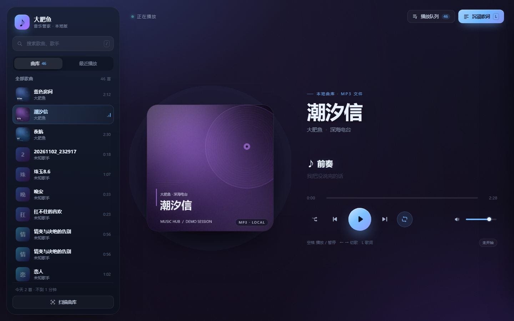
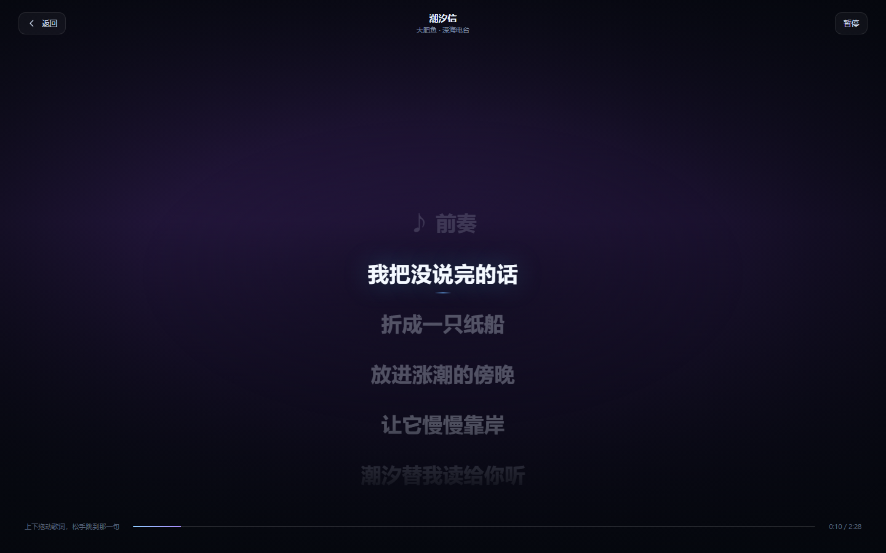
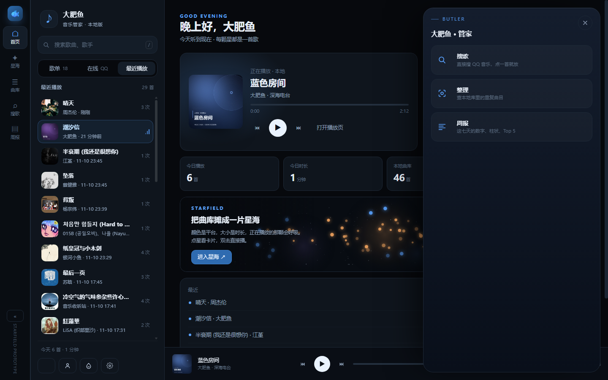
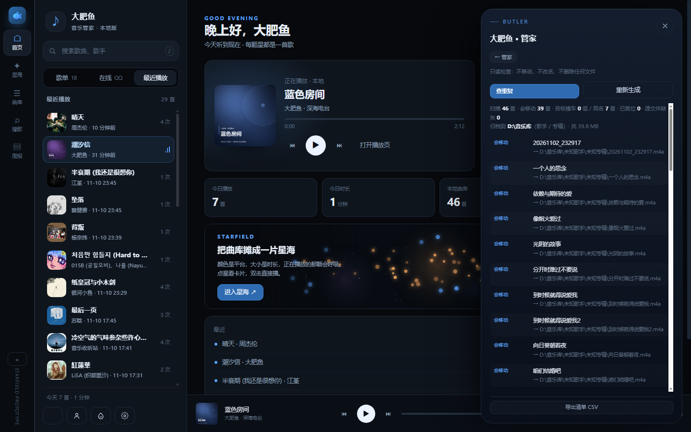
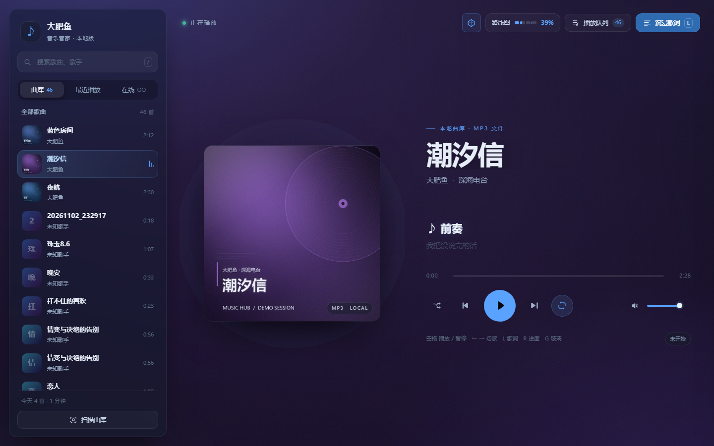
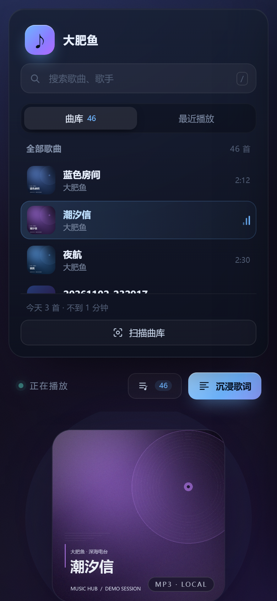

# 效果展示

真实运行的界面截图（1440×900 与手机尺寸），都是这台机器上跑出来的，不是设计稿。
点开任意一张可看大图。

---

## 播放器：主界面

左封面右歌词的双栏布局，顶部是曲库侧栏。播的是本地文件，右下角标着来源「本地」。

## 沉浸歌词

按 `F` 或双击封面进整屏歌词，`Esc` 退出。逐字高亮优先，音频时钟与歌词时钟有补偿。

## 管家抽屉

大肥鱼是**抽屉**，不是主界面：搜歌、歌单、整理、周报都从这里进。
曲库为空时设置弹窗会自动盖上来，所以说这个抽屉会主动把设置关掉，免得挡住右上角的关闭按钮。

## 整理计划：先预览再动手

整理走的是「探针 · 限速 · 断点 · run_id 回滚」流程：先出计划（目标歌单、数量、差异），
你点「可以」才执行；执行后记下 `run_id`，随时能回滚。**「我喜欢」只读，永远不作为写入/移动/删除的目标。**

## 玻璃拟态皮肤（可选）

默认是平色深色，玻璃是可选皮肤（右上角图标或按 `G` 切）。三条硬约束：
模糊 16–20px 不叠层、只给面板不给文字块、整屏歌词页不开玻璃（掉帧）。
`prefers-reduced-transparency` 时自动关。

## 手机布局

手机浏览器直连电脑上的后端（不跑本地后端），导航收成底部栏，歌词与队列给抽屉。

---

## 已经跑通的能力

| 能力 | 状态 |
|---|---|
| 本地曲库增量扫描、播放、封面/歌词 | ✅ |
| 沉浸歌词（逐字、时钟补偿、整屏切换） | ✅ |
| 听歌记录（按播放位置累计 `play_events`） | ✅ |
| QQ 搜索 / 取直链 / 后端代理播放 | ✅ |
| QQ 歌单浏览与导入 | ✅ |
| 网易云搜索与播放（非会员只给试听片段） | ✅ |
| 同曲多源优先级（QQ 全曲优先于网易云试听） | ✅ |
| 歌单管理（建/加/移/删、体检、整理工作流） | ✅ |
| 管家（对话式整理、周报） | ✅ |
| 局域网多用户 + 口令 + 失败锁定 | ✅ |
| 桌面壳（Electron，可打包 NSIS） | ✅ |

## 一些数字

- 后端空闲占用 60–110 MB；浏览器标签 150–300 MB（开动效 250–450 MB）
- 曲库索引是增量的，第二次启动只比对 mtime + size
- 在线直链内存缓存 300 秒，上游 401/403/404/410 时强制重取

> 想看某个功能怎么用，翻 [使用说明.md](使用说明.md)；想改界面，`web/tokens.css` 是唯一的令牌来源。
